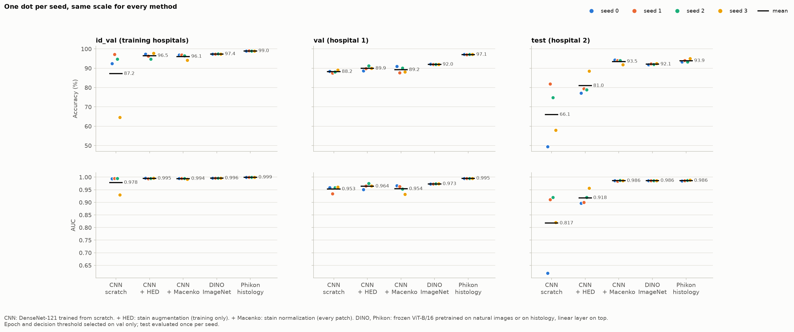
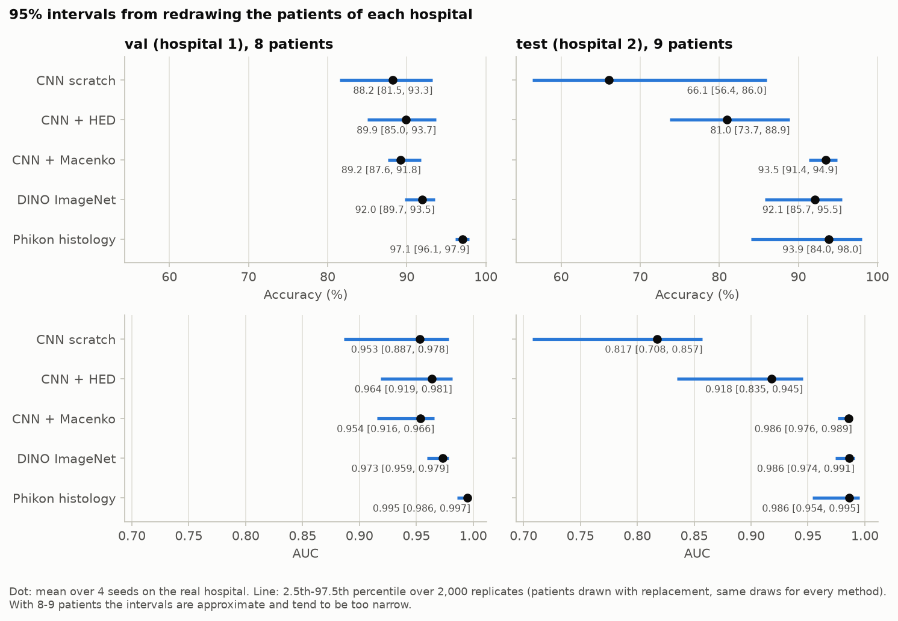

<!-- Generated by `python -m src.report` from docs/README.template.md and the files of results/. Do not edit by hand. -->

# Metastasis detection that survives a change of hospital

A CNN trained on three hospitals to find breast-cancer metastases in lymph-node patches falls to
66.1% accuracy on a hospital it has never seen; normalizing stain colors brings it to
93.5%, on par with frozen pathology foundation models.

**Demo:** not online yet. Hugging Face now requires a paid plan to host Gradio apps; the demo (tumor score,
heat map, referral of uncertain patches to a pathologist) runs locally with `python app/app.py`, see
[app/README.md](app/README.md).

**Key result.** Accuracy on the never-seen test hospital (mean of 4 training seeds; 95% interval when its
9 patients are redrawn):

| Method | Accuracy on the unseen test hospital | 95% interval |
|---|---|---|
| CNN from scratch | **66.1%** | [56.4, 86.0] |
| CNN + HED stain augmentation | **81.0%** | [73.7, 88.9] |
| CNN + Macenko stain normalization | **93.5%** | [91.4, 94.9] |
| Frozen DINO ViT-B/16 (natural images) + linear layer | **92.1%** | [85.7, 95.5] |
| Frozen Phikon ViT-B/16 (histology) + linear layer | **93.9%** | [84.0, 98.0] |

The three best methods cannot be told apart on this hospital (stain normalization minus Phikon:
-0.4 [-6.1, +8.6] points). The gain of stain normalization over stain augmentation holds:
+12.5 [+2.9, +19.3] points.



## Why it matters

Hospitals stain and scan their slides differently. A model that looks excellent on the hospitals it was
trained on can fail silently on a new one, which is exactly where a deployed model ends up.
[Camelyon17-WILDS](https://wilds.stanford.edu/datasets/#camelyon17) measures this: train on three hospitals,
choose the model on a fourth, test once on a fifth.

## Data

- 455,954 patches of 96 x 96 pixels from 50 lymph-node slides of 43 patients in 5
  hospitals; a patch is labeled tumor if its central 32 x 32 region is. Classes are balanced in every split.
- Official splits: train, hospitals 0, 3 and 4 (302,436 patches); id_val, same hospitals and slides
  (33,560); val, hospital 1, unseen (34,904, 8 patients); test, hospital 2, unseen
  (85,054, 9 patients).
- The official download server is unreachable (expired certificate): the data comes from a Hugging Face
  mirror pinned to one revision, then checked against the paper by [src/prepare_data.py](src/prepare_data.py)
  (split sizes, hospitals and slides per split, no slide shared between training and unseen hospitals);
  provenance in [results/data_provenance.json](results/data_provenance.json).
- Exploration: [notebooks/01_exploration.ipynb](notebooks/01_exploration.ipynb) (stain differences between
  hospitals, slides and patients behind the patches).

## Methods

Every method is trained with the same protocol (WILDS ERM: SGD, 10 epochs, [configs/](configs/)) with 4 seeds,
and its epoch and decision threshold are chosen on the validation hospital only.

1. **CNN from scratch:** DenseNet-121, the WILDS baseline.
2. **+ HED stain augmentation:** random changes of the hematoxylin and eosin amounts, at training time only.
3. **+ Macenko stain normalization:** every patch, at training and at prediction time, is re-expressed with
   reference stain colors computed on training patches only.
4. **Frozen DINO ViT-B/16** (pretrained on natural images): features extracted once, a linear layer trained
   on top.
5. **Frozen Phikon ViT-B/16** (pretrained on histology by Owkin): same, with a histology foundation model.

## Results

### Generalization to unseen hospitals

| Method | Training hospitals (id_val) | Hospital 1 (val, unseen) | Hospital 2 (test, unseen) | 95% interval over test patients | Test AUC |
|---|---|---|---|---|---|
| CNN from scratch | 87.2 ± 15.2 | 88.2 ± 0.7 | **66.1 ± 14.9** | [56.4, 86.0] | 0.817 |
| CNN + HED stain augmentation | 96.5 ± 1.3 | 89.9 ± 1.0 | **81.0 ± 5.1** | [73.7, 88.9] | 0.918 |
| CNN + Macenko stain normalization | 96.1 ± 1.3 | 89.2 ± 1.6 | **93.5 ± 1.1** | [91.4, 94.9] | 0.986 |
| Frozen DINO ViT-B/16 (natural images) + linear layer | 97.4 ± 0.0 | 92.0 ± 0.1 | **92.1 ± 0.3** | [85.7, 95.5] | 0.986 |
| Frozen Phikon ViT-B/16 (histology) + linear layer | 99.0 ± 0.0 | 97.1 ± 0.1 | **93.9 ± 0.8** | [84.0, 98.0] | 0.986 |

- **The baseline is consistent with WILDS:** 66.1 ± 14.9% on the test hospital, against
  70.3 ± 6.4% in the WILDS paper, with a large spread between seeds in both. Its failure is a bias: it calls
  only 18.7% of test patches tumor, for a true share of 50%.
- **Stain normalization fixes hospital 2, not hospital 1:** on the validation hospital, Macenko is not better
  than augmentation (+0.7 [-3.6, +4.0] points for HED), while on the test hospital it is far ahead.
- **One validation hospital is a weak guide to choose between methods,** since val and test can disagree. All
  methods are therefore reported, and none was picked using the test hospital.
- **Phikon is clearly best on the validation hospital** (+7.9 [+5.9, +9.0] points over Macenko),
  which is why the demo uses it.

### How sure are these numbers?

Two sources of uncertainty are measured separately: training randomness (4 seeds, ± standard deviation)
and the choice of patients (cluster bootstrap that redraws patients, 2,000 replicates, same draws for
every method). With only 8 and 9 patients the intervals are approximate, and one
test slide (slide 28) holds 37% of the test patches and
63% of its tumor patches.



### Is the displayed probability honest?

| Method | Temperature (fitted on val) | ECE, test hospital: before → after |
|---|---|---|
| CNN from scratch | 1.46 | 0.294 → 0.261 |
| CNN + HED stain augmentation | 1.32 | 0.126 → 0.113 |
| CNN + Macenko stain normalization | 1.34 | 0.046 → 0.067 |
| Frozen DINO ViT-B/16 (natural images) + linear layer | 1.13 | 0.070 → 0.073 |
| Frozen Phikon ViT-B/16 (histology) + linear layer | 0.85 | 0.039 → 0.040 |

A temperature fitted on the validation hospital barely helps, or hurts, on the test hospital: miscalibration is
mostly a shift whose direction depends on the hospital (models under- or over-call tumors), and a temperature
only rescales. Calibration is a property of a (model, hospital) pair; on a new hospital the score is a ranking,
not an exact probability. ([reliability diagrams](results/figures/reliability.png))

### Referring uncertain patches to a pathologist

The model may refer its least confident patches. With the cutoff chosen on the validation hospital to refer
20% of its patches, on the test hospital:

| Method | Error, all patches | Patches answered with referral | Error on answered patches |
|---|---|---|---|
| CNN from scratch | 33.9% | 76% | 29.7% |
| CNN + HED stain augmentation | 19.0% | 69% | 10.8% |
| CNN + Macenko stain normalization | 6.5% | 83% | 2.2% |
| Frozen DINO ViT-B/16 (natural images) + linear layer | 7.9% | 79% | 2.3% |
| Frozen Phikon ViT-B/16 (histology) + linear layer | 6.1% | 70% | 1.0% |

Referral helps good models and cannot save a biased one. A promise of coverage transfers better than a promise
of error: a cutoff set for 2% error on the validation hospital gives 4.3% error on the
test hospital for Phikon. ([risk-coverage curves](results/figures/risk_coverage.png))

### What the errors look like

480 test patches are misclassified by all five methods, 474 of them missed
tumors, mostly from slides 28 (236) and 29 (151): candidates for ambiguous or coarse labels, to be reviewed
by a pathologist ([galleries](results/figures/errors_test.png)). Grad-CAM shows that the CNNs use the whole
patch: the central cell, which the label describes, carries 14 to 17%
of the map against 11% for a uniform map ([Grad-CAM](results/figures/gradcam.png)).

## How the numbers were produced

- **The test hospital was never used to choose anything:** epochs, thresholds, temperatures, referral cutoffs,
  the demo model and its seed were all chosen on the validation hospital.
- **Seeds fixed in advance** (4 per method) and passed as a parameter; every run is one command
  (`python -m src.train --config configs/cnn_macenko.yaml --seed 0`).
- **Every result in this README is generated** by [src/report.py](src/report.py) from the files of
  [results/](results/); a test fails if the README and the results disagree.
- **Reproducible:** the saved predictions regenerate every table and figure (see the last section); training
  the 12 CNNs took about 41 GPU-hours on Kaggle T4s
  ([notebooks/kaggle_runner.ipynb](notebooks/kaggle_runner.ipynb)).
- **Checked:** the WILDS evaluator and our metrics agree on every run; the demo reproduces the saved predictions
  (largest gap 0.0016); its heat map changes when the last block's weights are randomized (rank
  correlation 0.07).

## Repository

```
configs/      one YAML per method (protocol, color method, features)
src/          data, color, train, probe, evaluate, aggregate, calibration, bootstrap, abstention, explain, report
notebooks/    data exploration; Kaggle runner for GPU training
results/      every table, figure and saved prediction behind this README
app/          Gradio demo (Phikon + linear head), self-contained; MODEL_CARD.md describes its model
tests/        unit tests (pytest)
LEARNING.md   what each phase taught, with interview questions (in French)
```

## How this project was built

This project was developed with [Claude Code](https://claude.com/claude-code) (Anthropic) as a pair-programmer
and mentor: each phase was planned, discussed and validated by the author, who can explain every line. The
reasoning behind each choice is in [LEARNING.md](LEARNING.md).

## Limitations

- **Two unseen hospitals only,** with 8 and 9 patients: nothing guarantees
  that the ranking of methods holds on a third hospital.
- **Patches, not patients:** no slide- or patient-level diagnosis. Labels come from hand-drawn contours and are
  imperfect (see the errors shared by all methods).
- **Calibration does not transfer** across hospitals; a new site would need local recalibration on a few
  labeled cases.
- **Confounded comparison:** CNN versus frozen ViT mixes architecture, pretraining and freezing. Only one HED
  strength was tested. Macenko is estimated per patch and overflows numerically on 0.03%
  of training patches (dominated by saturated pixels), left as is.
- **Research tool, not a medical device.** Not for diagnosis.

## Licenses

- Code: [MIT](LICENSE).
- Data: Camelyon17 (CC0 1.0), through the Camelyon17-WILDS release and a pinned Hugging Face mirror.
- Phikon weights: Owkin non-commercial license (used by the demo). DINO weights: Apache-2.0.

## Reproduce in 3 commands

```bash
pip install -r requirements.txt     # Python 3.12; exact versions in requirements-lock.txt
python -m src.prepare_data          # download and check Camelyon17-WILDS (needs about 25 GB free)
python -m src.reproduce             # every table and figure from the saved predictions, compared with results/
```

The last command reruns every analysis (a few minutes on a laptop) and fails if a number differs from
[results/](results/) by more than 1e-9 or a figure by a single byte. Retraining is documented in
[notebooks/kaggle_runner.ipynb](notebooks/kaggle_runner.ipynb).
